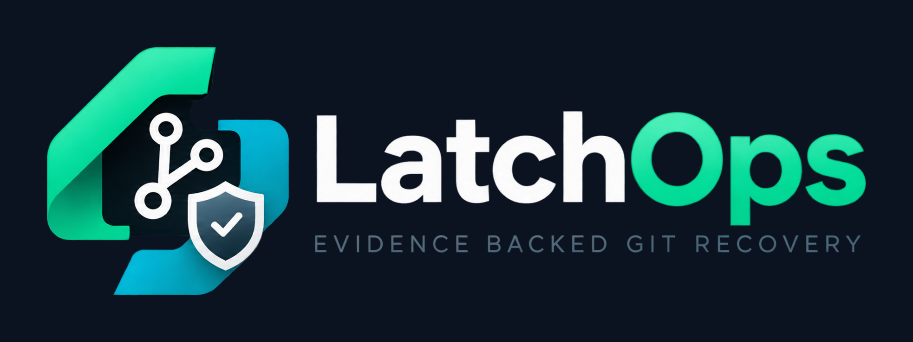

# LatchOps

<p align="center">
  
</p>

**Classify a dangerous Git state, explain it from evidence, and recover only after a person approves.**

LatchOps is a local safety layer for repository recovery. Deterministic engines classify the snapshot and write the plan. A local model may explain that evidence, but only with consent, and only claims that cite the evidence are shown. A second person approves one plan alternative. Execution happens in a throwaway repository, never in yours, and never pushes.

The current incident type is `merge_conflict`.

---

## Recovery Review

Open **http://127.0.0.1:3000/review** after:

```bash
pnpm install
pnpm review:setup          # build the engines and generate the review Prisma client
ollama pull qwen2.5:3b     # optional; evidence, approval, and execution work without it
pnpm review:dev            # Next.js bound to 127.0.0.1
```

Flow: **evidence → grounded explanation → explicit approval → isolated run**.

1. **Evidence.** `@latchops/state-engine` and `@latchops/recovery-engine` capture the snapshot and plan. Recovery Review numbers the facts (`E1`…), redacts secrets, re-scans the result, and hashes it.
2. **Explanation.** Optional. Consent is bound to that evidence hash and the model provider. Every claim must cite `E#` or runbook `K#`. If a key claim is unsupported, or the text contains a command or a verdict, the explanation is withheld.
3. **Approval.** An approver who is not the requester picks one engine alternative and writes a reason. The approval expires in 30 minutes and can be used once.
4. **Isolated run.** The server rebuilds the incident in a temporary repository, re-hashes it, and runs `authorizeExecution`. Only commands from the approved plan alternative can run. `verifyRecovery` decides `VERIFIED` or `FAILED`. A denied run is `BLOCKED`.

```bash
pnpm review:test           # unit tests and 20 scenario end-to-end tests; no model
pnpm review:eval           # baseline vs Recovery Review -> docs/submission/results/
```

`REVIEW_EVAL_LLM=1 pnpm review:eval` also calls the local model (direct context vs retrieval). On CPU that takes a long time.

Import a snapshot from your own repository with `pnpm cli snapshot --output snap.json`. Imported reviews are read-only: nothing is executed against that repository.

Korean submission notes: [`docs/submission/`](./docs/submission/README.md).

---

## Layout

| Piece | Role |
|---|---|
| `packages/schema` | Zod contracts: `SnapshotV1`, `RepoSignalsV1`, `RecoveryPlanV1` |
| `packages/state-engine` | `captureSnapshot`, `computeRepoSignals` |
| `packages/recovery-engine` | `generateRecoveryPlan`, `verifyRecovery` |
| `apps/cli` | Read-only `snapshot`, `diagnose`, `plan`, `verify`, `send` |
| `apps/web/src/lib/isolation` | Local Git workspace, plan-command allowlist, verdict |
| `apps/web/src/lib/review` | Evidence, consent, retrieval, validation, approval, audit |
| `apps/web` | Incident room and `/review` |

```text
SnapshotV1 → RepoSignalsV1 → RecoveryPlanV1
        → numbered evidence → optional cited explanation
        → human approval → isolated allowlisted exec → verifyRecovery
        → VERIFIED | FAILED | BLOCKED
```

---

## CLI

```bash
pnpm build:cli
pnpm cli diagnose
pnpm cli plan
pnpm cli snapshot --output snap.json
```

`snapshot`, `diagnose`, `plan`, and `verify` do not modify the repository they inspect.

---

## Hackathon archive

The Daytona / Nosana HackSprint proof (`/hacksprint`, `/proof`, sponsor keys) is not on this branch. The exact main tip from that demo is `archive/daytona-hacksprint` (`8c1d850`). The reusable Git pieces from that demo now live under `apps/web/src/lib/isolation`. The pre-review explanation evidence builder is `apps/web/src/lib/review/legacy-evidence.ts`, and it is used only to measure the baseline.

---

## Honesty

- Plans and verdicts come from the engines. The model does not write commands and does not decide `VERIFIED` or `FAILED`.
- Review scenarios rebuild a fictional checkout-service conflict. They are not a customer repository.
- A local model call is reported only after it returns. This repository's checked-in evaluation currently includes the deterministic 20-scenario run. A full direct-vs-retrieval model run was not completed on CPU; see `docs/submission/EVALUATION_KO.md`.
- Demo actor tokens on `/review` are local identities, not accounts.

## Brand assets

Raster crops of the supplied masters. These are not SVG files, and the glossy edges are the source artwork.

| Use | File |
|---|---|
| README and dark slides | `docs/brand/latchops-lockup-on-dark.png` (full mark and tagline on a dark plate, so the white wordmark stays visible) |
| Transparent lockup | `apps/web/public/brand/latchops-lockup.png` |
| Navigation, footer, sign-in | `apps/web/public/brand/latchops-wordmark.png` |
| Light surfaces | `apps/web/public/brand/latchops-wordmark-light.png` |
| App icon, favicon, Apple touch icon | `apps/web/src/app/icon.png`, `apps/web/src/app/apple-icon.png` |
| Monochrome symbol | `apps/web/public/brand/latchops-mono.png` (small disconnected specks removed; not used in the site chrome) |

Original files are in `branding/source/`. Do not upscale these rasters.

MIT
