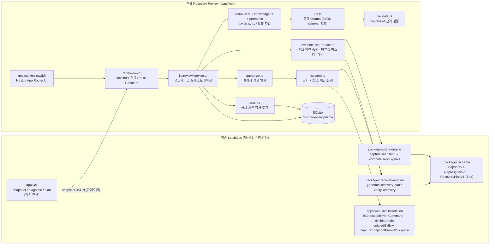
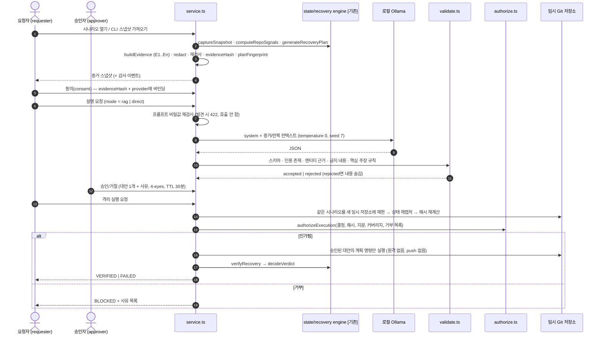
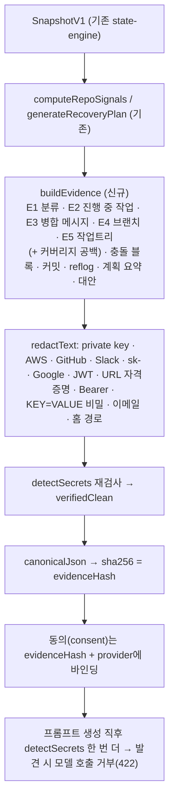
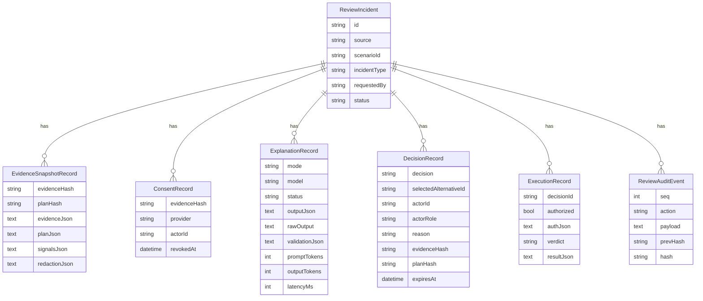
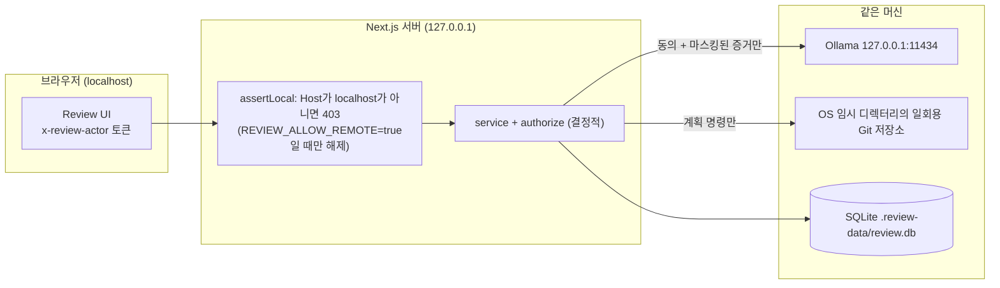

# LatchOps Recovery Review — 아키텍처

> 범위: 사고 유형 1개(`merge_conflict`), 로컬 전용(localhost + 로컬 Ollama + 로컬 SQLite), Next.js/TypeScript/Prisma.
> 표기: **[기존]** = 이번 학기 이전부터 저장소에 있던 모듈(재사용, 수정 없음), **[신규]** = 이번 최종 제출을 위해 새로 구현한 모듈.

## 1. 전체 구성

핵심 원칙은 세 가지입니다.

1. **증거가 먼저**: 모든 판단의 입력은 기존 결정적 엔진이 만든 스냅샷·신호·계획입니다. LLM은 이 증거에 대한 *설명*만 합니다.
2. **설명은 근거가 있을 때만 표시**: 모든 주장(claim)은 증거 ID(E#)나 런북 ID(K#)를 인용해야 하고, 검증기를 통과하지 못하면 화면에 "보류(withheld)"로만 표시됩니다.
3. **실행은 사람의 명시적 승인과 결정적 인가 뒤에만**: 실행 명령은 결정적 계획에서만 나오며, 모델 출력은 인가 함수의 입력이 아닙니다.

## 2. 요청 흐름 (증거 → 설명 → 승인 → 격리 실행)

## 3. 실행 정책 (K10이 참조하는 규칙)

`authorize.ts`의 `authorizeExecution()`은 순수 함수이며 아래 조건을 **모두** 만족해야 `allowed=true`를 반환합니다. 하나라도 어기면 사유가 누적되고 명령 목록은 비어 있습니다.

| # | 조건 | 위반 시 사유 예시 |
|---|---|---|
| 1 | 행위자가 `requester` 또는 `approver` 역할 | `role "viewer" cannot execute` |
| 2 | 사고 유형이 `merge_conflict` | `incident type … is out of scope` |
| 3 | 출처가 `scenario`(격리 재현 가능). CLI 가져오기는 실행 불가 | `no isolated replay is available for imported snapshots` |
| 4 | 승인은 1회용 | `this approval was already used for an execution` |
| 5 | 최신 결정이 `approve`, 결정자가 `approver`, 요청자 본인이 아님 | `latest decision is a rejection` / `four-eyes rule` |
| 6 | 승인 후 30분 이내 | `approval expired` |
| 7 | 승인이 가리키는 evidenceHash/planHash가 저장된 스냅샷과 일치 | `approval refers to different evidence` |
| 8 | 저장된 계획을 다시 지문화한 값이 승인 시 지문과 일치 (DB 변조 탐지) | `stored plan does not match the approved plan fingerprint (tampered)` |
| 9 | 실행 직전에 다시 캡처한 상태 해시가 승인 시 해시와 일치 | `repository state changed since approval (stale evidence)` |
| 10 | 캡처가 모든 미병합 경로와 충돌 블록을 담음 (천장: 파일 20, 블록 8) | `conflict evidence incomplete: plan covers N of M unmerged paths` |
| 11 | 요청한 대안이 승인된 대안과 동일하고 계획에 존재 | `approved alternative is …, requested …` |
| 12 | 모든 계획 명령이 거부 목록을 통과 (`push`, `fetch`, `clean`, `reset`, `checkout`, `--force`, `--hard`, `--exec*` 등) | `git push is never allowed` |
| 13 | 실제 실행 명령은 기존 `isExecutablePlanCommand` 허용 목록을 통과한 계획 명령뿐 | (허용 목록 밖 명령은 실행 목록에서 제외) |

추가 방어선:

- `isolated.ts`는 실행 전 `git remote`가 비어 있는지 확인하고, 시스템 임시 디렉터리 아래에서만 동작하며(경로 이탈 검사), `isolatedGitEnv()`로 전역 Git 설정을 차단합니다.
- 해결(resolution) 파일 쓰기는 "사람이 제공한 시나리오 고정 해결본"으로 표시되며 모델 출력이 아닙니다.
- `git add` 전에 충돌 마커(`<<<<<<<`, `=======`, `>>>>>>>`) 검사를 하여 마커가 남아 있으면 중단하고 **FAILED**로 판정합니다(S04).
- 판정(VERIFIED/FAILED)은 기존 `verifyRecovery` + `decideVerdict`만 내립니다. 설명 텍스트는 판정에 관여하지 않습니다.

## 4. 증거 스냅샷과 비밀값 처리

- 충돌 블록은 측(ours/theirs)당 600자로 자르고 잘림 사실을 `truncationNotes`에 기록합니다.
- 커밋 메시지·파일 내용·병합 메시지는 `untrusted: true`로 표시되어 프롬프트에서 "신뢰할 수 없는 저장소 텍스트"로 라벨링됩니다(프롬프트 인젝션 대비, S06).

## 5. 설명 생성: RAG vs 직접 주입

| 항목 | 직접 주입 (direct) | RAG (pinned + BM25) |
|---|---|---|
| 증거 | 모든 E# 항목 | 핵심 고정 항목(kind가 classification·operation·worktree·plan·alternative) + 나머지(충돌 블록·커밋·reflog·브랜치) 중 BM25 상위 6개 |
| 런북 | K1–K12 전부 | BM25 상위 3개 |
| 질의 | 없음 | 고정 질의어(merge conflict, MERGE_HEAD, markers, complete/abort, risk, configuration) + 작업트리 항목 텍스트 + 충돌 항목 라벨(경로 포함) |
| 장점 | 누락 위험 없음 | 컨텍스트가 커질 때(긴 히스토리, 다수 파일) 토큰·지연 감소 |
| 위험 | 긴 컨텍스트에서 지연·비용 증가, 중간 내용 누락(lost in the middle) | 검색 누락 시 근거 부족 → 검증기에서 거절됨 |

두 모드 모두 동일한 검증기를 통과해야 하므로, 검색 누락은 "근거 없는 주장"이 아니라 "거절/보류"로 나타납니다(fail-closed). 측정 결과는 `EVALUATION_KO.md`를 참고하십시오.

## 6. 검증기 (fail-closed)

`validateExplanation(raw, ctx)`는 다음을 순서대로 확인합니다.

1. JSON 파싱 → 실패 시 거절.
2. 문자열로 인코딩된 스칼라(`"null"`, 클레임 `key`의 `"true"/"false"`)만 정규화하고 그 내역을 `normalizations`에 기록. 내용 텍스트는 바꾸지 않습니다.
3. Zod 스키마(`ExplanationOutputSchema`) → 실패 시 거절.
4. 금지 내용: 위험 Git 명령, 계획에 없는 명령형 Git 텍스트, 셸 명령, "VERIFIED/안전/승인됨/푸시 준비" 같은 판정 주장(부정문 제외), "검토 불필요" 주장, 계획에 없는 추천 대안 → 하나라도 있으면 거절.
5. 각 주장: 인용 ID가 실제 컨텍스트에 있는지, 저장소 상태/핵심 주장은 E# 인용이 있는지, 주장에 등장한 경로·OID·`KEY=VALUE`·설정 키·숫자가 인용 항목 텍스트에 있는지, "N개 파일" 같은 개수가 실제 충돌 수와 맞는지.
6. 승인 조건: 스키마 유효 ∧ 금지 내용 없음 ∧ 핵심 주장 ≥ 1 ∧ 근거 없는 핵심 주장 = 0. 비핵심 주장 중 근거 없는 것은 숨기고 경고로 남깁니다.

## 7. 데이터 모델 (SQLite, `apps/web/prisma/review.prisma`)

- 기존 제품 DB(PostgreSQL, `prisma/schema.prisma`)는 건드리지 않습니다. Recovery Review는 별도 Prisma 스키마와 별도 클라이언트(`@prisma/review-client`)를 사용합니다.
- 감사 로그 해시 = `sha256(prevHash | incidentId | actorId | action | payload)`. `verifyAuditChain()`이 상세 화면을 열 때마다 체인을 다시 검증합니다.

## 8. 신뢰 경계

- 데모 사용자 토큰(`demo-requester-token` 등)은 로컬 데모용 식별자이며 인증 시스템이 아닙니다. `REVIEW_ACTORS` 환경변수로 교체할 수 있습니다.
- 사용자의 실제 저장소에는 어떤 명령도 실행하지 않습니다. CLI 스냅샷 가져오기는 검토 전용입니다.
